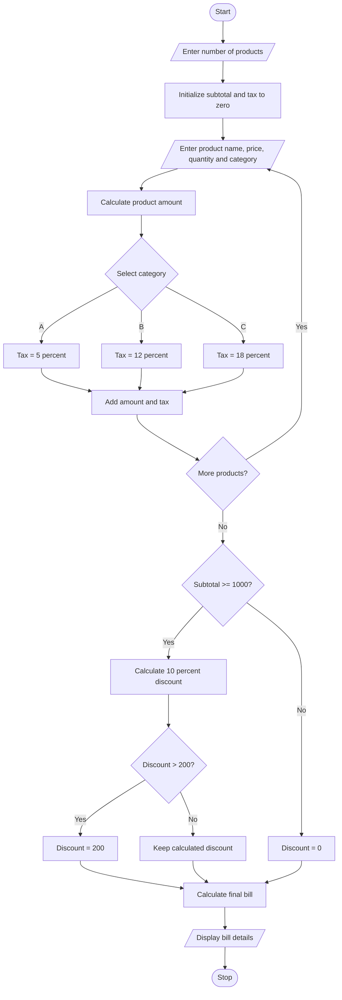

# Case Study 7: Retail Billing with Multiple Discount Rule

## 1. Problem Statement

Write a Python program to calculate a retail bill for multiple products based on their prices and quantities. Apply category-specific taxes and discount rules to calculate and display the final bill amount.

## 2. Algorithm

1. Start.
2. Enter the number of products.
3. Initialize subtotal and tax to zero.
4. Read the product name, price, quantity and category.
5. Calculate the product amount by multiplying price and quantity.
6. Apply tax based on the product category.
7. Add the product amount and tax to their respective totals.
8. If the subtotal is ₹1,000 or more, apply a 10% discount, limited to ₹200.
9. Calculate the final bill by adding tax and subtracting the discount.
10. Display subtotal, discount, tax and final bill.
11. Stop.

## 3. Flowchart (Mermaid)


## 5. Sample Input

```
Enter number of products: 2

Enter product name: Pen
Enter price: 100
Enter quantity: 5
Enter category A, B or C: A

Enter product name: Bag
Enter price: 500
Enter quantity: 2
Enter category A, B or C: B
```

## 6. Sample Output

```
Subtotal: 1500.0
Discount: 150.0
Tax: 145.0
Final Bill: 1495.0
```

