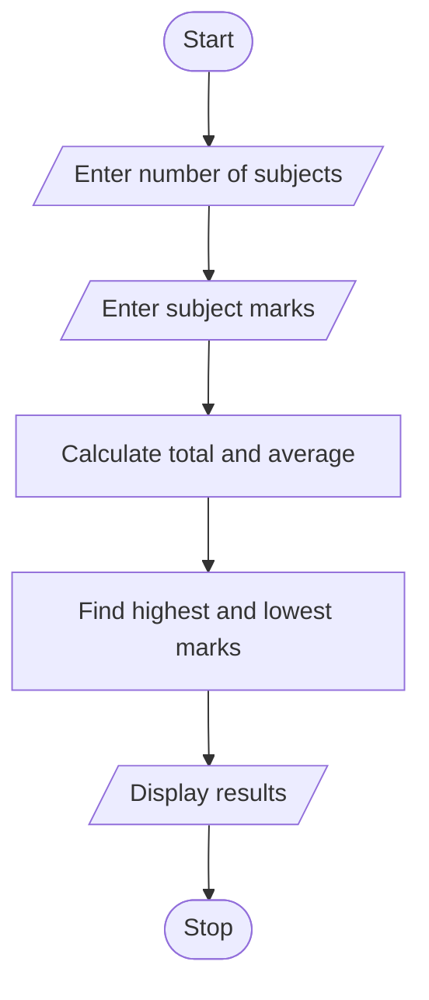

## Case Study No. 17 – Student Performance Trend Analysis

### 1. Problem Statement

Analyze a student's marks in different subjects and calculate the average, highest and lowest marks.

### 2. Algorithm

1. Start.
2. Enter the number of subjects.
3. Enter marks for each subject.
4. Calculate total and average marks.
5. Find highest and lowest marks.
6. Display the results.
7. Stop.

### 3. Flowchart 


### 5. Sample Input

```
Enter number of subjects: 3
Enter marks: 85
Enter marks: 90
Enter marks: 75
```

### 6. Sample Output

```
Total: 250
Average: 83.33333333333333
Highest: 90
Lowest: 75
```
