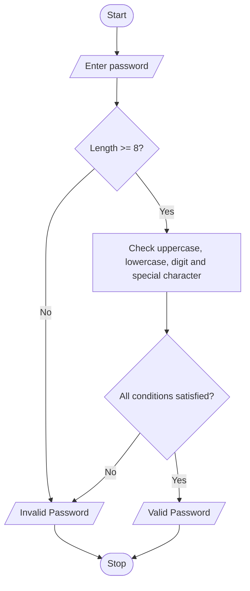

## Case Study No. 29– Password Policy Validation Engine

### 1. Problem Statement

Check whether a password satisfies the required conditions, such as minimum length, uppercase letters, lowercase letters, digits and special characters.

### 2. Algorithm

1. Start.
2. Enter a password.
3. Check its length.
4. Check for uppercase, lowercase, digit and special character.
5. If all conditions are satisfied, display Valid Password.
6. Otherwise, display Invalid Password.
7. Stop.

### 3. Flowchart 

### 5. Sample Input

```
Enter password: Hello@123
```

### 6. Sample Output

```
Valid Password
```
