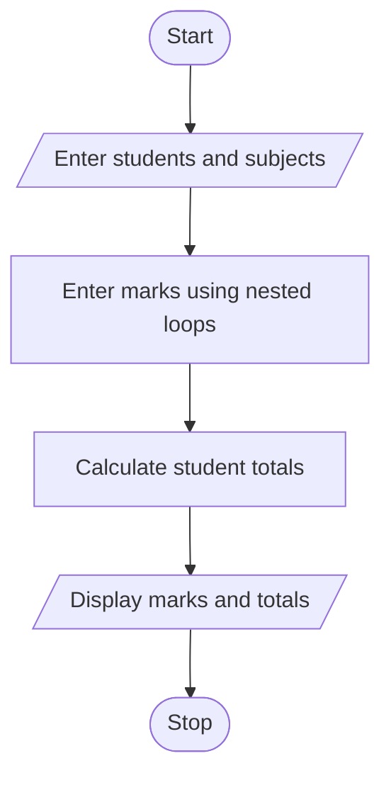

## Case Study No. 42– Student Marks Matrix Analysis

### 1. Problem Statement

Create a matrix of student marks and calculate the total marks of each student.

### 2. Algorithm

1. Start.
2. Enter the number of students and subjects.
3. Enter marks using nested loops.
4. Calculate each student's total marks.
5. Display the matrix and totals.
6. Stop.

### 3. Flowchart (Mermaid)


### 5. Sample Input

```
Enter number of students: 2
Enter number of subjects: 3
Enter marks: 80
Enter marks: 90
Enter marks: 70
Enter marks: 75
Enter marks: 85
Enter marks: 95
```

### 6. Sample Output

```
Student 1 Total: 240
Student 2 Total: 255
```
