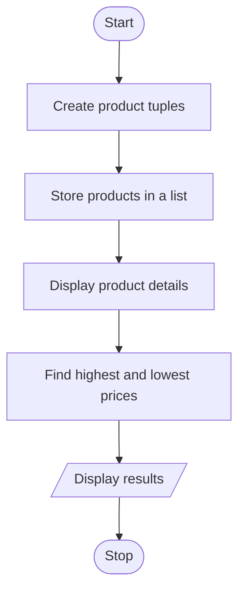

## Case Study No. 49 – Tuple-Based Product Catalogue Audit

### 1. Problem Statement

Store product details using tuples and display the product information, including the highest and lowest priced products.

### 2. Algorithm

1. Start.
2. Create tuples containing product ID, name and price.
3. Store the product tuples in a list.
4. Display all products.
5. Find the highest and lowest prices.
6. Display the results.
7. Stop.

### 3. Flowchart 


### 4. Sample Input

```
Product details are stored in the program.
```

### 5. Sample Output

```
(101, 'Pen', 10)
(102, 'Book', 50)
(103, 'Bag', 500)
Highest Price: 500
Lowest Price: 10
```
